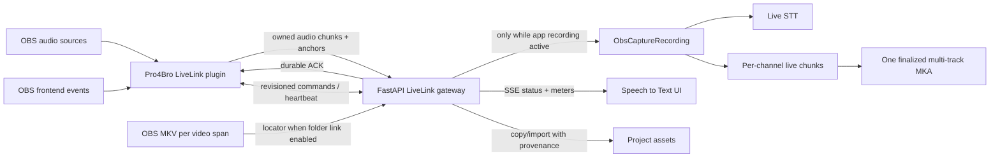

# OBS LiveLink: kế hoạch tích hợp và trải nghiệm người dùng

**Trạng thái:** Đã duyệt; L1 contract và L2 installer đã triển khai ở mức code/test, L3–L8 còn mở
**Ngày:** 2026-09-26
**Phạm vi tài liệu:** Thiết kế lại đường cài đặt, cấu hình, live capture,
điều khiển record và nhập bản ghi giữa OBS Studio và Pro4Bro Voice
Manipulator. L1 đã có schema/reducer/ADR/protocol; plugin và UI v3 chưa chạy.

## 1. Mục tiêu của ứng dụng

Pro4Bro Voice Manipulator là một audio workstation chạy local, theo project.
Trong ngữ cảnh họp trực tuyến, ứng dụng cần:

1. Nhận đồng thời nhiều nguồn âm thanh đã được OBS thu thập, ví dụ micro của
   người dùng, trình duyệt, Zoom, Teams, Zalo, Viber và các nguồn khác.
2. Giữ từng nguồn thành một stem riêng để live transcribe, chạy STT chính xác
   sau buổi họp, diarization theo từng nguồn và xuất Script/SRT có timeline.
3. Theo dõi chính xác vòng đời record/pause/stop của OBS, nhưng cho phép người
   dùng bỏ qua từng trigger khi muốn ứng dụng tiếp tục ghi độc lập.
4. Nhận file video cuối của OBS làm bản video chính thức, sau đó chạy lại STT,
   xuất SRT và render hard subtitle khi người dùng yêu cầu.
5. Hoạt động local, không làm hỏng quá trình record của OBS nếu ứng dụng hoặc
   API gặp lỗi.
6. Cài đặt và sử dụng được trên máy thử nghiệm mà không yêu cầu người dùng tự
   sửa UUID, token hoặc file cấu hình.

OBS là nguồn capture và clock tham chiếu cho video. Voice Manipulator quản lý
stem âm thanh, transcript, speaker metadata và các asset phát sinh trong
project.

## 2. Tình hình hiện tại

### 2.1 Những phần đã có

- Native OBS plugin cho Windows đã gửi được nhiều nguồn âm thanh độc lập đến
  FastAPI bằng protocol v2.
- Plugin đã theo dõi event start, pause, unpause và stop của OBS.
- Mỗi nguồn có queue riêng, sequence number, checksum, ACK bền vững, retry,
  reconnect và gap marker.
- Backend có live session, per-source stem, live STT và trạng thái nguồn.
- Trang Speech to Text có bảng hiện mang tên OBS Capture để xem session, live
  text, lỗi/gap và nhập MKV thủ công.
- Luồng STT chính xác, Script, SRT, diarization và hard subtitle đã có các phần
  xử lý nền tảng để tái sử dụng.
- Portable bundle đã chứa plugin, Python runtime, model và công cụ cài plugin.

### 2.2 Những phần chưa đáp ứng trải nghiệm mới

- Plugin không có mục trong menu **Tools** và không có dialog riêng trong OBS.
- Nguồn âm thanh hiện được chọn bằng UUID trong `config.json`; project ID và
  pairing token cũng phải cấu hình thủ công.
- `INSTALL-OBS-PLUGIN.bat` không cho người dùng biết plugin đã được cài đúng
  phiên bản hay OBS có cần restart hay không.
- Plugin chỉ gắn audio callback trong khi OBS đang record. Cách này không thể
  thực hiện đúng yêu cầu bỏ qua Pause hoặc Stop và tiếp tục ghi trong app.
- Bảng hiện mang tên OBS Capture trong app là status/import panel, chưa phải
  mixer có meter và nút bật/tắt từng kênh.
- Recorder chỉ hiểu `microphone` và `display`; chưa có capture source là OBS.
- Plugin chưa gửi chính xác file cuối từ `obs_frontend_get_last_recording()` cho
  app sau Stop.
- Chưa có clock map đầy đủ giữa sample clock của stem và timeline của MKV.
- Tên relay chưa được quản lý bằng UI; source role và diarization theo từng
  nguồn vẫn thuộc vòng `OBS-10`.

### 2.3 Kết luận đánh giá

Kiến trúc hiện tại là nền tảng có thể tiếp tục phát triển. Không cần viết lại
phần upload âm thanh, STT hoặc project asset. Cần nâng protocol, thêm control
plane, viết UI native của plugin và gom các live session rời thành một phiên
record cấp buổi họp.

Acceptance trên máy Windows khác với OBS thật của `PORT-03B` vẫn còn thiếu và
được chuyển sang gate cuối của `LIVELINK-08`. `PORT-03B` chỉ được đánh Complete
khi gate đó thực sự pass. Contract `LIVELINK-01` và installer `LIVELINK-02`
đã được triển khai ở mức code/test; vòng kế tiếp là `LIVELINK-03`.

Repo hiện pin OBS source headers `32.2.2`; script build mặc định dùng
`.cache/obs-studio-32.2.2` và `C:\Program Files\obs-studio`. Máy phát triển hiện
có `obs64.exe` version `32.2.2`, nhưng chưa có evidence plugin native mới load
và dialog chạy trong OBS thật. Phiên bản đã cài và nguồn headers chỉ là cơ sở
để chuẩn bị gate native ở `LIVELINK-03`, chưa phải chứng nhận tương thích.
L2 đã thêm Preferences installer, manifest/hash và API; plugin v2 vẫn cần
`config.json` cho tới khi L3 ghép nối tự động và thử load native trong OBS.

## 3. Các quyết định kiến trúc

### 3.1 Một phiên record, hai nơi hiển thị

Backend thêm aggregate `ObsCaptureRecording` làm chủ phiên ghi của app. Khung
OBS LiveLink và Recorder chỉ là hai view/controller của cùng aggregate. Không
tạo một bản ghi ở OBS LiveLink rồi tạo thêm bản ghi thứ hai khi người dùng chọn
OBS LiveLink trong Recorder.

Tên hiển thị trong sản phẩm là **OBS LiveLink**. Tên kỹ thuật
`ObsCaptureRecording`, `ObsCaptureController` và đường dẫn module hiện có được
giữ trong giai đoạn đầu vì chúng mô tả dữ liệu/capture controller, không phải
nhãn giao diện. Việc đổi tên symbol hoặc thư mục chỉ thực hiện sau bằng một
refactor riêng nếu giúp code rõ hơn và không làm migration phức tạp.

Các khái niệm mới:

| Khái niệm | Trách nhiệm |
| --- | --- |
| `ObsLiveLinkConnection` | Kết nối và control plane của một OBS instance; có thể Active khi app recording Idle |
| `ObsLiveLinkChannel` | Channel ID ổn định, source UUID, tên native, relay label/revision, slot và trạng thái forward |
| `ObsCaptureRecording` | Phiên app record nhiều channel; sở hữu audio chunks và tham chiếu 0..N OBS video spans giao với timeline của nó |
| `ObsVideoRecordingSpan` | Một lần OBS Start..Stop do connection quan sát, pause intervals, anchors, optional exact MKV locator và import provenance |
| `ObsTimelineAnchor` | Mốc clock/lifecycle để đối chiếu stem với từng OBS video span |
| `ObsRecordingLocator` | Đường dẫn máy cục bộ của một video span, chưa phải project asset |
| `ProjectTargetLease` | Quyền tạm thời của một workspace/project làm target cho một OBS connection |

`ObsLiveSession` v2 hiện tại tiếp tục được đọc để không làm mất dữ liệu cũ;
protocol v3 sẽ ghi theo aggregate mới.

### 3.2 LiveLink connection tách khỏi app recording

Khi người dùng bật **LiveLink**, plugin gắn callback vào các source đã chọn và
giữ connection, inventory, meter, lifecycle observation và control plane ngay
cả khi OBS chưa record, đang pause hoặc đã stop. `LiveLink Active` **không tạo**
`ObsCaptureRecording`: app recording vẫn có thể `Idle`. Full audio chunks chỉ
được gửi/lưu khi app recording ở trạng thái Recording, channel enabled và có
recording ID owner; trạng thái Paused tạo interval nhưng không lưu audio mới.
Không tạo orphan chunks.

Để Start trigger không mất âm đầu trong thời gian handshake, plugin giữ một
pre-roll ring buffer chỉ ở RAM, có giới hạn thời lượng/dung lượng. Sau khi
backend xác nhận recording ID và start boundary, plugin flush phần buffer nằm
trong recording span theo thứ tự sample/sequence rồi mới gửi live; buffer bị
hủy nếu không có recording owner. Dung lượng, giới hạn thời gian và trường hợp
overflow phải được chốt/test ở `LIVELINK-01`.

OBS recording và app recording trở thành hai state machine độc lập có các mốc
liên hệ rõ ràng. Một app recording có thể tham chiếu 0, 1 hoặc nhiều video
spans: ví dụ Ignore Stop giữ app recording, OBS Stop rồi Start tạo video span
kế tiếp. Span được quan sát ở connection kể cả khi app chưa record; nếu người
dùng bấm Record trong app giữa một OBS span, app recording tham chiếu phần
timeline giao với span đó. Một span có thể giao với nhiều app recordings khi
người dùng Stop/Start thủ công trong lúc OBS vẫn record.
Head/tail nằm ngoài spans vẫn ở stem, không bị nén vào timeline của MKV/SRT.
Tắt LiveLink tháo callback, kết thúc forwarding và xử lý app recording đang
active theo một transition tường minh được chốt ở `LIVELINK-01`.

Trạng thái không gộp thành một boolean: `linked` là connection còn sống;
`enabled/forward` là channel được chọn để gửi khi capture; `armed` là có
project-target lease hợp lệ; `recording` là app aggregate đang lưu audio;
`paused` là app recording đang ngừng nhận mẫu vì một hay nhiều pause causes.

### 3.3 Data plane và control plane

- **Data plane:** giữ HTTP chunk upload + durable ACK đang có cho recording
  active. Mỗi source có queue riêng; audio callback không chờ mạng, đĩa hoặc UI.
- **Control plane:** thêm long polling có server/connection epoch và revision
  giữa plugin và API. Cách này
  tái sử dụng WinHTTP và retry hiện tại, có ít rủi ro build hơn WebSocket ở vòng
  đầu. Ví dụ:
  `GET /api/obs-livelink/v3/connections/{id}/commands?epoch=<epoch>&after=<revision>&wait_seconds=20`.
- **Plugin status:** hello khi kết nối, heartbeat định kỳ, source inventory khi
  thay đổi và một meter batch khoảng 5-10 lần/giây.
- **Web UI:** API phát status/meter bằng Server-Sent Events; polling chậm hơn là
  fallback khi SSE ngắt.

Mỗi connection có một logical command consumer. Command có stable ID,
`desiredState`, revision và ACK mang `appliedState`/error cùng applied monotonic
timestamp hoặc sample boundary. UI hiển thị `pending` đến khi nhận ACK hợp lệ.
Sau API restart hoặc epoch đổi, plugin làm full-state resync trước khi nhận
command mới; stale ACK và duplicate command không được apply lần hai.



### 3.4 Pairing và project-target lease

- Preferences ghi install identity, API endpoint loopback và launcher path vào
  machine-local state; mỗi Windows user có pairing identity/token ngẫu nhiên
  riêng trong per-user config. Binary machine-wide tách khỏi config/secret.
  Token không nằm trong project, Git, UI, log hoặc URL.
- Workspace có project đang mở xin `ProjectTargetLease` cho một OBS
  connection/install cụ thể. Lease chứa project ID, workspace/browser instance
  ID, owner ID, revision và expiry; chỉ owner được renew/release. Khung OBS
  LiveLink hiển thị lease nhưng không cần luôn mở để renew khi workspace còn
  active. Tab/project khác không thể chiếm target bằng heartbeat cuối cùng.
- Khi owner rời project, tab đóng hoặc lease hết hạn, plugin thấy
  `No active project`; app không tự chuyển target sang project khác. Capture
  đang active dùng project đã pin ở recording ID và có thể tiếp tục ghi sau
  khi browser tab đóng; không đổi đích giữa phiên.
  Active target là machine-local connection state, không ghi vào project data.
- Dialog trong OBS hiển thị tên project đang active. Nếu chưa có target, nút
  **Open Pro4Bro Voice Manipulator** mở app và hướng dẫn người dùng mở/tạo
  project.
- Nút Open App kiểm tra health endpoint trước. Nếu app chưa chạy, plugin gọi
  launcher được Preferences ghi sẵn, sau đó mở đúng local URL/intent.
- Không còn yêu cầu người dùng nhập project ID, token hoặc source UUID.

### 3.5 File âm thanh mặc định cho phiên nhiều nguồn

**Đề xuất mặc định:** một file audio-only `source.mka` (Matroska Audio) cho
mỗi `ObsCaptureRecording`. Mỗi nguồn OBS có một **audio track độc lập**, mang
channel ID/source UUID và relay label; một nguồn stereo vẫn là một track
stereo. Không ghép nhiều nguồn độc lập thành các channel của một WAV/FLAC
stream. Encode mỗi track bằng FLAC lossless đối với PCM integer nhận từ plugin;
nếu định dạng nguồn không tương thích FLAC thì chọn PCM lossless phù hợp và ghi
rõ format. Không resample/downmix ngầm khi tạo bản nguồn chính.

| Định dạng | Có thể chỉ chứa âm thanh? | Cách gom nguồn | Vai trò đề xuất |
| --- | --- | --- | --- |
| `.mka` | Có | Nhiều audio tracks độc lập | Bản record mặc định của app |
| `.m4a` | Có | Nhiều audio tracks với AAC/ALAC | Export khi cần hệ sinh thái MP4 |
| `.wav`/RF64/BWF, `.caf` | Có | Chủ yếu là một stream PCM nhiều channels | Export cho DAW khi source/channel mapping đã được xác nhận |
| `.mkv`/`.mp4` | Có thể chứa video và nhiều audio tracks | Video + audio tracks, hoặc audio-only trong một số trường hợp | OBS MKV là video chính thức; app không cần video trong bản audio archive |

Một track stereo là hai audio channels nhưng vẫn chỉ đại diện một nguồn OBS.
Một file FLAC thông thường là một audio stream, không tự tạo được N tracks
độc lập; FLAC ở đây là codec của từng track trong MKA.
WAV là container thường dùng cho audio PCM; MKA lưu **PCM audio track**, không nhúng nguyên
file `.wav` làm track. Nếu cần data chưa nén trong file chính, dùng PCM
`s16le` cho từng track MKA, đổi lại dung lượng lớn hơn. Mặc định FLAC nén
lossless từng track PCM integer mà plugin gửi đến, nên giải mã trở lại đúng
sample PCM đầu vào; không dùng codec lossy cho source archive.

Trong lúc record, backend tiếp tục ACK và lưu chunk theo từng nguồn để phục vụ
live STT và recovery. Việc có thêm/mất nguồn giữa buổi được phản ánh bằng
channel identity và interval. Sau Stop, backend dựng `source.mka.part` từ các
chunk, khai báo toàn bộ tracks, verify số track/timestamp/codec/hash rồi đổi
tên nguyên tử thành `source.mka`. Nếu đóng gói lỗi, chunk còn nguyên để retry;
không báo record hoàn tất khi artifact chưa tồn tại. Cách đóng gói sau Stop
tránh phụ thuộc vào việc thêm track vào giữa một Matroska file đang ghi.

`source.mka` là **source media canonical** trong project; các stem được nhìn
như child tracks theo stream index/track UID, mỗi track có transcript và source
provenance riêng. Media Pool hiện yêu cầu file nguồn riêng cho mỗi asset, vì
vậy `LIVELINK-01` phải chốt contract tham chiếu track trong một parent asset
và migration cho WAV stems v2; `LIVELINK-07A` sẽ triển khai đường ghi/đọc đó.
STT đọc từng track riêng: giải mã FLAC/PCM từ MKA thành `analysis.wav` PCM
16-bit, mono, 24 kHz theo pipeline OBS hiện có. Đây là derivative cho STT,
không phải định dạng source archive hoặc một bản record nguồn thứ hai. Tốc độ
24 kHz là lựa chọn hiện hành của app, có thể tạo derivative khác nếu engine
STT yêu cầu; không downmix các nguồn OBS với nhau. Live STT nhận PCM/chunk
theo nguồn ngay khi record, không chờ MKA được finalize. Manifest project chỉ
lưu path tương đối đến MKA; analysis WAV có thể tạo lại từ track tương ứng.
Một JSON manifest chứa mapping track UID ↔ source UUID/channel ID/alias
revision, sample/clock anchors và gap/disabled intervals được nhúng làm
attachment `pro4bro-session.json` để file đứng riêng vẫn có provenance; JSON
không chứa token hoặc đường dẫn tuyệt đối. App có thể mix các track để nghe
tổng; track mixdown thêm vào MKA chỉ khi người dùng chọn export kèm bản nghe
tổng, và không được dùng cho per-source STT.

OBS tiếp tục ghi video chính thức thành MKV riêng. `source.mka` thuộc app và
`source.mkv` thuộc OBS được liên kết bằng video spans/time anchors ở mục 5.
Matroska quy định `.mka` cho audio-only và hỗ trợ nhiều tracks/attachments;
FLAC là codec lossless, không phải tên container.

Nguồn tham chiếu:

- [Matroska FAQ về `.mka`](https://www.matroska.org/faq.html)
- [Matroska track layout](https://www.matroska.org/technical/diagram.html)
- [Matroska codec mappings: FLAC và PCM](https://www.matroska.org/technical/codec_specs.html)
- [Matroska attachments](https://www.matroska.org/technical/attachments.html)
- [FLAC FAQ về nhiều nguồn độc lập](https://www.xiph.org/flac/faq.html)
- [FFmpeg muxers và định dạng M4A](https://ffmpeg.org/ffmpeg-formats.html)
- [EBU RF64 nhiều channel](https://tech.ebu.ch/publications/tech3306)
- [Apple CAF specification](https://developer.apple.com/library/archive/documentation/MusicAudio/Reference/CAFSpec/CAF_spec/CAF_spec.html)

## 4. Trải nghiệm mục tiêu

### 4.1 Preferences: cài plugin bằng một dòng tích hợp

Trong Preferences thêm card **OBS Studio LiveLink**. Đây là thao tác tích hợp,
không phải một field chỉ được áp dụng khi bấm Save chung.

Thông tin hiển thị:

- OBS path và version đã phát hiện.
- Kiểu cài đặt: standard hoặc portable/custom.
- Plugin version, hash và trạng thái: Not installed, Installed, Update
  available, Damaged, OBS restart required.
- Trạng thái OBS đang chạy.

Hành động:

- **Install**, **Update**, **Repair**, **Remove**.
- **Choose OBS folder** cho bản portable/custom.
- **Open OBS** sau khi cài thành công.

OBS hướng dẫn plugin Windows standard trong
`%ProgramData%\obs-studio\plugins\pro4bro-obs-bridge\`, với DLL ở
`bin\64bit\` và dữ liệu/locale ở `data\locale\`. Installer thử ghi bằng
quyền hiện tại; chỉ gọi helper elevation có allowlist khi access check thất
bại. Helper khóa source artifact, destination, manifest và hash, không mở API
copy tùy ý. Với OBS portable/custom, người dùng chọn OBS root; app xác minh
executable, mode và plugin paths của đúng bản OBS đó rồi ghi DLL dưới
`obs-plugins/64bit` và locale dưới `data/obs-plugins/<module>` theo source OBS
32.2.2 đã pin; không mặc định áp ProgramData.

OBS running/DLL loaded được xử lý theo từng action:

| Action | OBS đang chạy hoặc DLL loaded |
| --- | --- |
| Install mới | Có thể copy nếu đích chưa có DLL loaded; báo `Installed; restart required`, không báo đã loaded |
| Update | Yêu cầu đóng OBS trước khi thay DLL; giữ version cũ nếu hủy |
| Repair | Nếu cần thay DLL thì yêu cầu đóng OBS; nếu chỉ kiểm tra hash/config thì chạy được; giữ pairing secret |
| Remove | Yêu cầu đóng OBS trước khi xóa DLL/data; hỏi riêng việc giữ hay xóa per-user pairing config |

Nếu elevation bị hủy hoặc copy/verify lỗi, rollback phần thay đổi và báo action
chưa hoàn tất. Với OBS chưa chạy, install/update/repair vẫn báo rõ rằng plugin
chỉ được xác nhận loaded sau lần OBS khởi động tiếp theo.

Nguồn tham chiếu:

- [OBS Plugin Guide](https://obsproject.com/kb/plugins-guide)
- [OBS Frontend API](https://docs.obsproject.com/reference-frontend-api)

### 4.2 OBS: Tools > Pro4Bro Voice Manipulator LiveLink

Plugin đăng ký một modeless dialog bằng
`obs_frontend_add_tools_menu_item`. Dialog được parent vào main window của OBS,
có thể đóng và mở lại mà không làm mất mapping.

#### Khu vực đầu dialog

- Connection: Disconnected, Connecting, Connected hoặc Error.
- Active project và tên app instance.
- OBS recording state.
- Nút **Open Pro4Bro Voice Manipulator**.

#### Khu vực channel

Một vùng cuộn ngang chứa các channel strip do plugin tự vẽ bằng Qt. Giao diện
gần với OBS Audio Mixer nhưng không dùng widget nội bộ/private của OBS.

Mỗi strip gồm:

1. Scope: Global hoặc Active.
2. Tên source native của OBS.
3. Stereo/mono meter và peak hold.
4. Trạng thái muted/offline/missing.
5. Toggle **Forward to Voice Manipulator**.
6. Alias selector:
   - `Channel 1` đến `Channel N`, trong đó N là số audio source hiện có.
   - `Custom…` nằm đầu list và mở text input.
   - Alias không rỗng, tối đa 80 ký tự, loại control character và không trùng
     nhau theo so sánh không phân biệt hoa/thường.

Plugin dùng public source API để enumerate source có `OBS_SOURCE_AUDIO`, lưu
`sourceUuid`, channel ID, `obsSourceName`, `relayLabel`, alias revision và
`slot`. Mapping được lưu theo OBS scene collection. Đổi tên source chỉ cập
nhật native name; relay label ổn định. Source tái tạo với cùng tên nhưng UUID
mới là channel mới, trừ khi người dùng thực hiện migration rõ ràng. Xóa source
đánh dấu slot tombstone để giữ lịch sử; không tự đánh lại số các channel còn
lại. Slot tombstone chỉ được tái dùng sau khi app recording liên quan kết thúc;
trong lúc đó source mới chưa forward cho đến khi được gán một slot còn trống
trong `1..N` hoặc Custom alias. Channel ID/UUID, không phải `Channel N`, là
identity của stem.

Meter dùng `obs_volmeter` và được throttle; nó không làm thay đổi fader hoặc mute
của OBS. App cũng không điều khiển gain/mute của OBS trong phạm vi này.

#### Khu vực option

- **Connect to OBS recording folder**.
- **Control app recording from OBS**.
- Ba checkbox con: Start Recording, Pause/Resume Recording, Stop Recording.
- Tùy chọn **Enable LiveLink automatically when OBS starts**; mặc định tắt vì
  audio capture là hành vi cần người dùng chủ động. Mapping vẫn được lưu.

#### Khu vực cuối dialog

- Nút chính **Start LiveLink** / **Stop LiveLink**.
- Số channel đang forward, tốc độ gửi, queue/backpressure và lỗi gần nhất.

Click Start LiveLink áp dụng mapping hiện tại ngay. Thay đổi source hoặc alias
trong khi đang live được áp dụng nóng và tạo alias revision trong protocol.
Khi Connect to OBS recording folder tắt, plugin không công bố folder/locator
cho app; người dùng vẫn có thể Browse thủ công. Khi bật, plugin công bố
recording folder và exact completed locator sau mỗi OBS Stop.

### 4.3 App: khung OBS LiveLink

Bảng này chỉ tiếp nhận, giám sát và điều khiển LiveLink. Nó không sao chép toàn
bộ UI của Recorder.

Header hiển thị:

- OBS/plugin version, connection và active project.
- OBS recording state, app recording state.
- Recording folder mà plugin công bố khi kết nối kho record được bật.
- Nút mở dialog hướng dẫn khi chưa kết nối.

Phần channel là các strip ngang/cuộn tương tự dialog OBS:

- Relay label là tên chính; native OBS source name là dòng phụ.
- Meter và peak.
- Connection `Linked/Disconnected`, project `Armed/No active project`, channel
  `Forward enabled/disabled` và app capture `Idle/Recording/Paused/Stopped`
  được trình bày riêng. Mỗi strip cũng thể hiện missing, muted, user-disabled,
  transport-gap và STT-error khi có.
- Toggle bật/tắt forward riêng từng channel.

Khi tắt một channel trong app, backend gửi command đến plugin. Sau ACK, plugin
ngừng enqueue channel đó. Nếu app recording active, ACK/event ghi applied
sample/timestamp boundary và backend tạo interval `user-disabled` với start/end
và duration rõ ràng. Khi app Idle, toggle chỉ đổi desired/forward state, không
tạo persisted interval. Đây không phải network gap. Khi bật lại, cùng
source/channel trong phiên tiếp tục, timeline được bù silence/marker thay vì
dồn audio làm lệch thời gian.

### 4.4 Recorder: Capture Source = OBS LiveLink

`Capture Source` có thêm lựa chọn **OBS LiveLink**.

Khi chọn:

- Khối Mic Input được thay bằng danh sách channel đang linked.
- Mỗi dòng có relay label, native source name, meter và icon Idle, Recording,
  Paused, Stopped, Missing hoặc Disabled.
- Nút Record/Pause/Stop điều khiển `ObsCaptureRecording` chung qua backend.
- Các channel hiện thành child tracks của một recording trong Media Pool;
  mỗi track vẫn có transcript/STT riêng.

Recorder hiện dùng browser `MediaRecorder` và trả một `CapturedAudio`; interface
này không chứa được nhiều stem. Cần tách controller:

- `BrowserCaptureController` cho microphone/display hiện tại.
- `ObsCaptureController` cho backend-owned multi-channel session.

Không tải stream OBS qua browser rồi record lại bằng `MediaRecorder`.

### 4.5 Trigger và Ignore trigger from OBS

Trong khung OBS LiveLink có control:

**Ignore trigger from OBS:** `[Start Recording] [Pause Recording] [Stop Recording]`

Đây là multi-select có checkbox. Policy lưu theo machine/project preference,
không ghi vào portable `project.json`.

Plugin luôn gửi tất cả lifecycle anchor, kể cả khi forwarding/ignore policy nói
app không đổi state. Điều đó giữ đủ dữ liệu đồng bộ. Trigger có event ID,
connection epoch, OBS video span ID và sequence tăng đơn điệu. Reducer dedupe
event lặp, không áp event cũ đến muộn lên state mới và resync state khi phát
hiện mất sequence.

| Event từ OBS | Không ignore | Đã ignore |
| --- | --- | --- |
| Start | Nếu app idle và target lease hợp lệ, tạo/start phiên; nếu đã record, mở thêm `ObsVideoRecordingSpan` trong cùng phiên | App giữ state hiện tại; nếu đang record, vẫn mở video span và ghi start anchor |
| Pause | Thêm `obs-automation` vào pause causes của app recording; đóng media interval đang chạy của video span | Không thêm pause cause; app tiếp tục theo các pause causes khác; đóng media interval của video span |
| Unpause | Chỉ xóa pause cause do chính OBS automation tạo; manual pause vẫn còn | Không thay đổi app pause causes; mở media interval tiếp theo của video span |
| Stop | Đóng video span, nhận exact MKV locator và finalize app recording | Đóng video span, nhận exact MKV locator; app recording tiếp tục và có thể gắn video span mới ở OBS Start sau |

`manual` và `obs-automation` là pause causes độc lập. App chỉ tiếp tục ghi khi
set pause causes rỗng. Nếu người dùng đổi Ignore policy giữa phiên, policy mới
áp dụng từ event OBS tiếp theo; không tự resume/pause ngược cho event đã xử lý.
Unpause chỉ giải phóng OBS pause cause đang có, kể cả policy Pause vừa đổi;
nó không xóa manual pause. Một OBS span có pause intervals riêng để video
timeline vẫn đúng khi app giữ trạng thái khác OBS.

Nếu người dùng bấm Stop trong app khi OBS vẫn record, app dừng nhận/ghi theo
policy của nó nhưng OBS không bị điều khiển ngược và không bị ảnh hưởng.

### 4.6 Import MKV from OBS và Browse

Nút hiện tại được đổi thành:

- **Import MKV from OBS**: khi kết nối kho record bật, ưu tiên exact completed
  locator của video span mới nhất chưa import, do plugin gửi từ
  `obs_frontend_get_last_recording()` sau
  OBS Stop. Nếu chưa có locator, scan folder đã công bố và lấy file `.mkv`
  hoàn tất mới nhất; không lấy file OBS đang ghi. Khi kết nối kho record tắt,
  nút báo cần bật option đó.
- **Browse**: mở picker tại recording folder mà OBS công bố nếu có, nếu không
  thì tại folder app chọn gần nhất. Người dùng có thể chọn file/folder khác;
  lựa chọn tạm không tự đổi default nếu chưa bật Remember.

Một app recording có thể đưa ra nhiều MKV, mỗi file gắn với đúng video span.
Import kiểm tra trùng bằng machine locator, size, mtime và fingerprint nội dung.
Đường dẫn tuyệt đối chỉ tồn tại trong machine-local pending state. Khi import,
file được copy/link theo policy hiện có vào project và project chỉ lưu path
tương đối, video span ID và provenance.

## 5. Đồng bộ thời gian

OBS plugin API cung cấp software timestamps; nó không biến hệ thống thành phần
cứng genlock. Vì vậy UI và tài liệu dùng từ **OBS synchronized timecode** hoặc
**timeline synchronization**, không hứa hẹn hardware genlock/LTC.

`LIVELINK-01` chốt evidence, đơn vị đo, thứ tự monotonic và quy tắc
discontinuity/interval; thuật toán hiệu chỉnh được đo và chọn ở `LIVELINK-08`.
Mỗi nguồn gửi:

- `obsAudioTimestampNs` từ audio callback.
- `sampleRate`, channel layout, frame/sample count, first sample index và
  sequence.
- OBS lifecycle anchors với plugin monotonic timestamp tại
  start/pause/unpause/stop.
- Plugin monotonic timestamp và app receipt time để chẩn đoán transport.
- App recording ID, OBS video span ID, channel ID và alias revision.

Sau khi có MKV, ffprobe đọc stream PTS/time base. Mapping dự kiến được đo:

```text
source sample clock + OBS lifecycle anchors -> MKV media timeline per video span
```

App receipt time không được dùng làm media timestamp chính vì network queue có
jitter. Audio ghi khi OBS pause hoặc sau OBS stop vẫn thuộc stem của app nhưng
không có video counterpart. SRT/hardsub gắn vào MKV phải loại hoặc đánh dấu các
segment ngoài video span; tuyệt đối không nén chúng vào timeline video.

Mục tiêu nghiệm thu: **absolute sync error của từng measured cue ≤ 200 ms**,
không tính average, tại đầu, giữa, cuối bản ghi 30 phút và hai phía của
pause/resume. Lưu raw offset từng cue, phương pháp đo và MKV/span ID. Bổ sung
intermediate cues khi test harness hỗ trợ. Kết quả synthetic hiện có không thay
thế phép đo spoken sync thật.

## 6. Protocol v3 đề xuất

### 6.1 Hello, epoch và minimal connection

`POST /api/obs-livelink/v3/hello`

- `installId`, OBS process instance ID, plugin version, OBS version.
- Scene collection ID/name.
- Record state; recording folder chỉ khi user bật Connect to OBS recording
  folder.
- Từ `LIVELINK-05`: audio source inventory gồm UUID, native name, channel
  layout, sample rate, active/global và muted/missing; active channel mapping
  và alias revision.

Response trả connection ID, `serverEpoch`, `connectionEpoch`, active
`ProjectTargetLease` summary, server protocol range, command revision và policy.
`LIVELINK-03` triển khai hello/authentication, heartbeat lease và connection
status tối thiểu. Source inventory synchronization và meter payload bắt đầu ở
`LIVELINK-05` sau khi mixer local đã có ở `LIVELINK-04`.

Khi API restart hoặc connection được tạo lại, epoch đổi; plugin không tiếp tục
`afterRevision` cũ. Nó hello lại, nhận snapshot đầy đủ gồm active recording
ID, target lease, per-channel desired/applied state và audio ACK high-water
marks, rồi mới tiếp tục upload và command. Retry audio theo sequence/hash
idempotent; không gán chunk cũ cho recording mới.

### 6.2 Heartbeat và meter

`POST /api/obs-livelink/v3/connections/{id}/heartbeat`

- Plugin/app/OBS state, last error, current epoch và lease revision từ L3.
- Queue depth, dropped frames, batched RMS/peak values từ L5; không gửi một
  HTTP request cho từng meter tick.
- Source inventory revision khi có add/remove/rename/scene change từ L5.

### 6.3 Command channel

`GET /api/obs-livelink/v3/connections/{id}/commands?epoch=<epoch>&after=<revision>`

- Long poll theo server/connection epoch và `afterRevision`; chỉ một logical
  consumer cho mỗi OBS connection. Concurrent/duplicate polls nhận cùng
  snapshot nhưng không tự apply command hai lần.
- Command: set channel enabled, set alias, start/pause/resume/stop app capture,
  refresh inventory, open/focus app.
- Command có stable ID, revision, desired state, target connection/recording ID
  và idempotency key. Plugin giữ applied command IDs qua reconnect của cùng
  OBS process; duplicate không chạy lại side effect.
- ACK có command ID, epoch/revision, applied state hoặc structured error và
  applied monotonic timestamp cùng sample/sequence boundary cho thao tác làm
  đổi timeline. Backend chỉ nhận ACK đúng epoch/command ID; stale ACK bị bỏ.
- Mất sequence, server revision reset hay epoch mismatch buộc full-state
  resync. Snapshot sau resync giải quyết desired/applied divergence và công bố
  interval/gap chưa xác định, không âm thầm coi command đã chạy.

### 6.4 Audio chunk

Mở session và chunk bổ sung:

- Connection ID/epoch, capture recording ID đang active.
- Source UUID, channel ID, alias revision.
- OBS audio timestamp, first sample index, frame/sample count.
- Sequence, payload hash và codec/format.

Plugin không upload full audio chunk khi app recording Idle. Pre-roll RAM được
gắn ownership sau start handshake như mục 3.2; dữ liệu quá giới hạn được đánh
dấu explicit gap nếu đã có recording, hoặc hủy nếu chưa có owner.
Final archive `source.mka` ở mục 3.5 được dựng từ chính các chunk đã ACK;
không tạo thêm một capture path song song có thể lệch dữ liệu.

### 6.5 Lifecycle/timeline anchor

Trong khi LiveLink Active, event v3 luôn được ghi ở connection, độc lập với
automation policy; chỉ liên kết project khi có recording owner hợp lệ:

- LiveLink started/stopped.
- OBS recording started/paused/unpaused/stopped kèm video span ID và event
  sequence/monotonic timestamp, kể cả khi app không record.
- App recording started/paused/resumed/stopped.
- Channel enabled/disabled/missing/restored.
- Scene collection changed.
- Completed recording locator cho đúng video span, cùng import status/provenance,
  chỉ khi user bật Connect to OBS recording folder.

Reducer dùng `(install ID, OBS process instance, event sequence)` ổn định qua
API restart để dedupe; video span ID kiểm tra đúng lifecycle và causal order.
Server/connection epoch áp dụng cho command stream, không làm event replay
trở thành event mới. Event cũ đến sau event mới không được quay lui app state;
thiếu sequence buộc resync, không đoán transition. App recording tham chiếu
0..N video spans; span không giao với app recording vẫn được quan sát ở
connection để người dùng có thể import MKV.
Mọi request mutate phải idempotent để retry không tạo record hoặc event trùng.

## 7. Cài đặt, bảo mật và portability

### 7.1 Package

Portable bundle hiện tại chứa DLL nguồn tại
`build/obs-plugin/RelWithDebInfo/pro4bro-obs-bridge.dll` và
`plugins/obs-pro4bro-bridge/config.example.json`. Installer v2 lấy DLL từ
đường dẫn đó và ghi vào plugin-owned directory dưới `ProgramData`; nó chưa
đóng gói một tree `obs-plugins/64bit` như bản nháp trước mô tả.

Bundle v3 sẽ tạo staging artifact có manifest/hash và dữ liệu plugin:

```text
obs-plugin-package/
  pro4bro-obs-bridge.dll
  locale/...
  manifest.json
```

Installer **transform/copy** staging files sang destination cụ thể:

```text
Standard OBS:
  %ProgramData%/obs-studio/plugins/pro4bro-obs-bridge/
    bin/64bit/pro4bro-obs-bridge.dll
    data/locale/...

Portable/custom OBS 32.2.2 root đã xác minh:
  <OBS root>/obs-plugins/64bit/pro4bro-obs-bridge.dll
  <OBS root>/data/obs-plugins/pro4bro-obs-bridge/locale/...
```

Không copy nguyên staging tree vào mọi install mode. `manifest.json` ghi plugin
version, exact tested OBS revision, architecture và SHA-256. App không cần
compiler trên máy đích. Mutable config/token ở profile user có ACL phù hợp;
binary/locale machine-wide không chứa secret. Các đường OBS-root trên là module
paths từ source của OBS 32.2.2; installer phải xác minh layout và mode của
instance đã chọn, và phải xem lại path khi hỗ trợ OBS revision khác.

### 7.2 Qt compatibility

Dialog cần Qt Widgets, trong khi CMake hiện tại chưa link Qt. Native build phải
dùng dependency bundle/toolchain tương thích đúng Qt ABI của **OBS Studio
32.2.2 x64 Windows**, là revision đã cài và có source headers trong repo cache.
Trước khi gọi `LIVELINK-03` Complete phải pin exact OBS executable/build,
dependency bundle và Qt revision, compile, load và mở dialog trên development
machine. Không copy một Qt DLL riêng vào OBS. L3 native acceptance khác với
clean-machine/bundle acceptance của L8. Chỉ công bố compatibility với revision
đã build/test; mở matrix khi có evidence cho revision khác.

### 7.3 Bảo mật

- Chỉ bind loopback trong giai đoạn này.
- Token ngẫu nhiên cho mỗi Windows-user pairing, compare constant time. Repair
  chỉ sửa binary, data/locale hoặc hash và **giữ secret hiện tại**. Token chỉ rotate khi
  explicit re-pair/reset, reinstall có chủ đích hoặc xử lý sự cố bảo mật.
- Plugin-to-API hello, heartbeat, audio/lifecycle, command retrieval và ACK
  đều authenticate cùng install ID và per-user pairing identity. API-to-web
  actions cũng kiểm tra project target/lease.
- Không log hoặc đưa token vào clipboard/UI/project/URL/query string. Token
  ở per-user config với ACL phù hợp, không trong binary directory machine-wide.
- Installer chỉ chấp nhận OBS root đã verify và artifact có hash trong manifest.
- Không expose endpoint copy file tùy ý.
- Source label được giới hạn độ dài, loại control character và escape khi xuất.
- Recording locator được validate dưới recording root do OBS công bố; file ngoài
  root chỉ đi qua Browse do người dùng chủ động.
- Network, disk, hashing và STT không chạy trên audio callback thread.

## 8. Các vòng triển khai

Mỗi vòng dưới đây là một development round độc lập, có diff và evidence riêng.

### LIVELINK-01 — Chốt domain, protocol và state machine

**Mục tiêu:** đóng băng evidence/protocol/state semantics của v3 trước khi cùng
lúc sửa native plugin, backend và UI. Thuật toán hiệu chỉnh MKV vẫn để đo ở L8.

**Công việc:**

- Thêm ADR cho connection, channel identity/tombstone, project-target lease,
  capture recording, 0..N video spans, source MKA/child track references và
  timeline anchors.
- Viết schema v3 và migration/read path cho live session v2.
- Cài pure state reducer cho OBS state, app state, pause causes, ignore policy
  và channel state; event order, duplicate, stale và policy change được test.
- Chốt timing evidence, units, monotonicity/discontinuity và interval semantics
  cho pause, disabled, gap, pre-roll, app-only span; chưa freeze correction map.
- Chốt epoch, command ID/idempotency, resync, auth và version negotiation.

**File chính dự kiến:**

- `CONTEXT.md`
- `docs/adr/0012-obs-livelink-v3.md`
- `docs/OBS-LIVELINK-PROTOCOL-V3.md`
- `services/api/app/domain/models.py`
- `services/api/tests/test_obs_livelink_state.py`

**Nghiệm thu:** state table trong mục 4.5 có test, gồm manual Pause + OBS
Unpause, đổi Ignore policy, Ignore Stop rồi OBS Start lần nữa, duplicate/out of
order; recording Idle khi LiveLink Active và v2 project/session đọc được.
Contract timing evidence và parent MKA/child track persistence đã rõ, WAV
stems v2 vẫn đọc được; thuật toán MKV chưa bị chốt khi thiếu số đo.

### LIVELINK-02 — Installer và Preferences integration

**Mục tiêu:** cài/update/repair plugin từ Preferences, bỏ thao tác copy thủ công.

**Công việc:**

- Adapter phát hiện standard OBS và cho chọn portable root.
- API read status và các imperative action có allowlist.
- Hash/manifest verification, standard ProgramData `bin/64bit` + `data`,
  OBS-root layout riêng, least-privilege write/elevation và rollback khi lỗi.
- Preferences card và trạng thái restart/OBS running.
- Bundle plugin data/locale, launcher metadata; lưu token riêng trong per-user
  config, giữ secret khi Repair và có explicit re-pair/reset.

**File chính dự kiến:**

- `services/api/app/adapters/obs_installation.py`
- `services/api/app/main.py`
- `services/api/app/domain/models.py`
- `apps/web/src/app/WorkspaceShell.tsx`
- `apps/web/src/api/client.ts`
- `scripts/install-obs-plugin.ps1`
- `scripts/build-portable-bundle.ps1`

**Nghiệm thu:** install/update/repair/remove qua UI; normal write được dùng
khi có quyền, UAC chỉ xuất hiện khi cần; custom root không hợp lệ bị từ chối;
hash/status chính xác; OBS chạy/loaded được xử lý riêng cho từng action;
Repair giữ pairing secret; binary/config đặt đúng hai security scopes. L2 chỉ
nghiệm thu installer/status với plugin artifact hiện có; dialog native được
nghiệm thu ở L3.

### LIVELINK-03 — Tools dialog, Open App và automatic pairing

Implementation note (2026-09-26): the development-machine build uses a
Windows-owned modeless dialog rather than Qt Widgets. OBS ships the Qt runtime
but this checkout has no Qt development headers/libraries; the Win32 dialog
loaded in OBS 32.2.2 and avoids adding an unverified SDK dependency. This is
an intentional departure from the Qt implementation detail below. Source
strips/meters in LIVELINK-04 should revisit that choice before expanding UI.

**Mục tiêu:** plugin có bề mặt điều khiển native đầu tiên và không cần sửa
`config.json`.

**Công việc:**

- Link Qt Widgets tương thích với OBS build.
- Pin exact OBS 32.2.2 executable/build, source SDK và Qt dependency revision;
  build và load thử dialog trong OBS phát triển thật.
- Đăng ký Tools menu và modeless dialog.
- Connection header, active project và Open App.
- Health check, launcher handshake, authenticated v3 hello, minimal connection
  heartbeat, project-target lease/acquire/renew/expiry và status.
- Giữ v2 config parser làm migration fallback trong một release.

**File chính dự kiến:**

- `plugins/obs-pro4bro-bridge/CMakeLists.txt`
- `plugins/obs-pro4bro-bridge/src/plugin-main.cpp`
- `plugins/obs-pro4bro-bridge/src/livelink-dialog.*`
- `plugins/obs-pro4bro-bridge/src/app-connection.*`
- `apps/web/src/modules/obs-capture/ObsCapture.tsx`
- backend LiveLink routes/store.

**Nghiệm thu:** menu Tools xuất hiện; dialog mở/đóng lại ổn định; Open App mở
đúng portable launcher; project lease active hiện trong OBS và hết hạn thành
`No active project`; hai tab/project không làm target flapping; token/UUID/
project ID không phải nhập tay. Gate này cần native runtime trên máy phát triển
OBS 32.2.2 thật; clean-machine compatibility vẫn ở L8.

### LIVELINK-04 — Source inventory, mixer strip và alias

**Mục tiêu:** cấu hình channel trực quan từ danh sách Audio Mixer thực tế.

**Công việc:**

- Enumerate/dedupe audio source bằng public OBS APIs và UUID.
- Theo dõi add/remove/rename và scene collection switch.
- Plugin-owned mixer strip, volmeter throttling, forward toggle và alias editor.
- Persist mapping per scene collection; alias revision khi đổi giữa phiên.
- Giữ channel identity theo UUID; source cùng tên/UUID mới không tự kế thừa;
  tombstone slot chỉ tái dùng sau khi recording liên quan kết thúc.
- UI virtualization/throttle khi có nhiều source.

**Nghiệm thu:** với bố cục 5 source như hình tham chiếu, dialog hiển thị đủ 5
strip, meter phản ứng đúng, chọn bất kỳ tập source nào, alias unique; đổi tên và
thêm/xóa source không làm mất mapping của source còn lại; slot recycle không
làm channel cũ và mới có cùng identity.

### LIVELINK-05 — Control plane và OBS LiveLink mixer trong app

**Mục tiêu:** app thấy và điều khiển từng channel trong thời gian thực.

**Công việc:**

- Mở rộng handshake L3 với inventory synchronization, long-poll command/ACK,
  desired/applied state và server/connection epoch recovery.
- SSE state/meter cho web.
- OBS LiveLink header, strip, trạng thái và per-channel toggle.
- Toggle khi app Idle cập nhật forward state; ACK chứa applied boundary và
  contract `user-disabled` để L6 ghi interval khi recording active.
- Một logical command consumer, duplicate/stale ACK handling, full-state
  resync, backpressure và API restart recovery trên v3.

**Nghiệm thu:** app và OBS đồng nhất source/alias/state; toggle được ACK trong
500 ms trên localhost khi cả hai process khỏe; toggle khi Idle không tạo
recording; restart API không crash OBS; epoch/revision reset không mất command
hoặc apply hai lần, plugin reconnect không trùng chunk; ACK có applied boundary
cho timeline. Persistent `user-disabled` interval được nghiệm thu ở L6.

### LIVELINK-06 — Recorder OBS LiveLink và trigger/ignore matrix

**Mục tiêu:** record nhiều channel từ Recorder và tuân thủ đúng policy trigger.

**Công việc:**

- Tách browser/OBS capture controller.
- Thêm OBS LiveLink trong selector và channel rows/status icons.
- `ObsCaptureRecording` group lifecycle, bounded volatile pre-roll, 0..N
  `ObsVideoRecordingSpan` và per-channel durable chunk/finalize path. Trước
  L7A, WAV stems hiện có là artifact chuyển tiếp để kiểm thử record.
- Ghi `user-disabled` interval khi toggle trong recording; phân biệt với
  transport gap và giữ sample timeline khi resume.
- Multi-select Ignore trigger cùng policy persistence.
- Automation state machine cho Start/Pause/Resume/Stop, pause causes,
  event order và manual app control.

**Nghiệm thu:** test toàn bộ ma trận mục 4.5; Start không tạo phiên trùng;
ignore Pause/Stop vẫn tiếp tục audio; OBS Stop rồi Start mới gắn video span thứ
hai vào cùng app recording; manual Pause không bị OBS Unpause xóa; manual Stop
không dừng OBS; disabled interval không bị tính là transport gap; stem vào Media
Pool có cùng group/timeline provenance. Bản record nguồn một file được nghiệm
thu ở L7A.

### LIVELINK-07A — Audio-only MKA nhiều track

**Mục tiêu:** hoàn tất một file âm thanh nguồn cho mỗi app recording trong khi
vẫn giữ từng OBS source độc lập cho STT/diarization.

**Công việc:**

- Dựng `source.mka` từ durable chunks sau Stop; một FLAC/PCM track cho mỗi
  source UUID/channel ID, gồm cả nguồn thêm hoặc mất giữa phiên.
- Nhúng `pro4bro-session.json` có track mapping/clock/gap provenance, filename
  cố định và không chứa token/absolute path; verify attachment khi đọc lại.
- Media Pool parent MKA + child track references; STT giải mã đúng stream index
  và tạo analysis WAV PCM16 mono 24 kHz khi cần, không trộn các OBS source.
  WAV stems v2 tiếp tục mở được.
- Atomic finalize, retry từ chunks sau crash và chính sách dọn chunk/derivative
  chỉ sau khi MKA đã verify; không giữ full source WAV song song mặc định.

**Nghiệm thu:** 1/2/5 source thành đúng 1 `.mka` source asset, có đúng số audio
tracks/tên/UID và manifest; FLAC decode khớp PCM nhận từ plugin; PCM track
fallback được đọc lại; source thêm giữa buổi vẫn có track riêng; từng track
được giải mã thành analysis WAV và chạy STT riêng; file/project chuyển
máy vẫn mở được; finalize lỗi giữ chunks để retry.

### LIVELINK-07B — Recording folder và MKV handoff

**Mục tiêu:** hoàn thành phần còn thiếu của `OBS-09` và UX import video mới.

**Công việc:**

- Khi user bật Connect to OBS recording folder, plugin gửi current recording
  folder và exact last recording sau từng OBS Stop, gắn locator với đúng span.
- `Import MKV from OBS`, fallback latest completed MKV và `Browse` đúng initial
  folder.
- Chặn file đang ghi, duplicate import và path traversal.
- Copy/import vào project với path tương đối và source provenance.
- Hỗ trợ app tiếp tục record sau OBS Stop và thêm span mới khi OBS Start lại.

**Nghiệm thu:** import đúng file vừa record dù tên/timestamp gần nhau; Browse mở
đúng folder; import lại không tạo asset trùng; move/reconnect project vẫn mở
được asset; app-only tail không bị gắn sai vào MKV.
Hai lần OBS record trong một app recording tạo hai locator/import statuses riêng.

### LIVELINK-08 — Time reconciliation và end-to-end acceptance

**Mục tiêu:** chứng minh toàn bộ trải nghiệm trên clean Windows machine với OBS
thật, đồng thời hoàn tất acceptance còn thiếu của `PORT-03B`.

**Công việc:**

- Đo, chọn và hiệu chỉnh map từ sample clock + lifecycle anchors sang MKV PTS
  theo từng video span; giữ raw offsets để review.
- Kết nối lại finalized STT, per-source transcript, Script/SRT và hard subtitle.
- Chạy 1, 2 và 5 source; pause/resume; ignore pause/stop; API restart; source
  mất/khôi phục; scene collection switch.
- Test 30 phút với lời nói và video clap/sync cues ở đầu, giữa, cuối và quanh
  pause/resume; lưu raw measured offsets, không chỉ một giá trị trung bình.
- Verify portable install, project move, runtime/model load và uninstall/repair.

**Nghiệm thu:**

- Absolute sync error của **từng cue** không quá 200 ms tại đầu, giữa, cuối
  và quanh pause/resume của từng video span.
- Không mất hoặc trùng audio ngoài interval đã đánh dấu.
- OBS record hoàn tất bình thường khi app/API bị kill.
- SRT giữ timeline, speaker label khi đã diarize và source provenance.
- Plugin cài qua Preferences trên máy sạch, xuất hiện trong Tools và không cần
  sửa file tay.
- Acceptance trên máy Windows/OBS khác còn thiếu của `PORT-03B` pass; chỉ lúc
  đó mới đánh `PORT-03B` Complete.

### OBS-10 — Source role và per-source diarization

Thực hiện sau `LIVELINK-08`:

- Gắn role `primary-microphone`, `meeting-application` hoặc custom cho channel.
- Chạy diarization độc lập theo stem khi người dùng chọn.
- Hiển thị source/role trong Voice Speaker của Script.
- Xuất SRT với timeline và speaker đã xác định.

Relay label của LiveLink không tự động được coi là speaker identity. Một source
application có thể chứa nhiều khách; một micro có thể chứa người dùng chính và
người khác trong phòng.

## 9. Dependency và critical path

```mermaid
flowchart LR
    L1[LIVELINK-01 contract] --> L2[LIVELINK-02 install]
    L2 --> L3[LIVELINK-03 dialog/pairing]
    L3 --> L4[LIVELINK-04 sources/mixer]
    L4 --> L5[LIVELINK-05 protocol/app mixer]
    L5 --> L6[LIVELINK-06 recorder/triggers]
    L6 --> L7A[LIVELINK-07A MKA audio archive]
    L7A --> L7B[LIVELINK-07B MKV handoff]
    L7B --> L8[LIVELINK-08 acceptance]
    L8 --> O10[OBS-10 roles/diarization]
```



Phần lớn critical path là tuần tự vì native plugin, API state và recorder cùng
chia protocol. Sau `LIVELINK-01`, mock UI và native build harness có thể làm
song song nếu sau này chủ dự án giao rõ file ownership cho Worker.

## 10. Validation matrix

| Nhóm | Test bắt buộc |
| --- | --- |
| Native build | Release x64, đúng OBS SDK/dependency, load/unload/reopen dialog |
| Install | Standard plugin-owned `bin/64bit` + `data`, OBS-root portable layout, normal write/UAC only when needed, hash mismatch, OBS running, repair secret preserved, remove |
| Source | 0/1/2/5/20 source, duplicate name, same-name/new-UUID, rename, remove, tombstone/reuse, scene collection switch |
| Audio | 44.1/48 kHz, mono/stereo, silence, clipping, long queue, reconnect, sequence/hash/gap |
| Audio archive | 1/2/5-source MKA, source thêm giữa phiên, FLAC bit-exact với received PCM, track title/UID/manifest, crash/retry, moved project, không nhân đôi source media mặc định |
| Control | LiveLink Active/app Idle, two project tabs/lease expiry, Start/Pause/Resume/Stop, manual pause ownership, ignore change mid-record, duplicate/reordered event, epoch restart/resync |
| Channel toggle | Disable/enable while Idle/Recording, desired/ACK mismatch/stale ACK, applied sample boundary, source missing |
| MKV | 0/1/2 OBS video spans per app recording, exact last path per span, fallback latest, file still open, duplicate import, alternate Browse path, folder link off |
| Timing | 30 phút, raw absolute offset mỗi cue ở đầu/giữa/cuối và quanh pause, ignored span, app-only head/tail, pre-roll overflow |
| Failure | Kill API/app/network, disk full, STT failure; OBS recording vẫn an toàn |
| Portability | Clean machine, moved bundle, moved project, relative assets, no system Python |
| Product | Live STT, finalized STT, Script, SRT, optional diarization/hard subtitle |

Mỗi round chạy focused backend/native/frontend tests. Vòng tích hợp chạy tối
thiểu:

- Backend: project Python `-m pytest services/api/tests -q`.
- Frontend: `npm test`, `npm run typecheck`, `npm run build` từ `apps/web`.
- Native: configure/build Release và load trong OBS target version.
- `git diff --check`, portable audit và kiểm tra `engines/OmniVoice` sạch.

## 11. Rủi ro và cách giảm thiểu

| Rủi ro | Cách xử lý |
| --- | --- |
| Qt ABI không khớp OBS | Pin OBS 32.2.2 executable/SDK/dependencies, load native dialog từ L3; không ship Qt riêng |
| DLL bị khóa khi update/remove | Detect OBS process và loaded module; giữ bản cũ khi hủy, verify hash sau copy |
| Danh sách source khác mixer đang nhìn thấy | Ghi rõ Global/Active, dùng public API và test scene collection/hidden source |
| Meter làm tăng CPU/network | `obs_volmeter`, batch 5-10 Hz, throttle/virtualize UI |
| Alias/slot/source đổi giữa phiên | Stable UUID + channel ID + alias revision; tombstone/reuse rõ, không match theo tên |
| Một file âm thanh nhưng nhiều nguồn động | ACKed per-source chunks trong lúc live, dựng MKA sau Stop, verify trước khi xóa/reclaim chunks |
| Player ngoài app có thể chỉ phát một track được chọn | App mix để preview; tùy chọn thêm mixdown track khi export ngoài app |
| Project target bị hai tab đổi qua lại | Lease có owner/revision/expiry; mất lease thành No active project, recording đã bắt đầu giữ project pin |
| API restart hoặc ACK cũ | Epoch, stable command ID, một consumer, full-state resync và audio ACK high-water mark |
| Ignore pause/stop tạo đoạn không có video | Lưu 0..N video spans riêng, loại/đánh dấu segment ngoài span khi xuất SRT/hardsub |
| Start handshake chậm | Bounded RAM pre-roll, ghi gap khi tràn sau ownership, không tạo orphan chunks |
| Callback bị block | Lock-free/bounded enqueue; mọi I/O ở worker thread; drop có marker |
| Source mất giữa phiên | State Missing, event/interval rõ ràng, tự attach lại theo UUID khi trở lại |
| App/project chưa sẵn sàng | Dialog báo No active project, Open App; không tự ghi vào project tùy ý |
| MKV lớn/trùng | Exact locator, completed-file check, fingerprint và streaming copy/progress |
| Plugin lỗi làm ảnh hưởng OBS | Exception boundary, bounded memory, watchdog/reconnect; app failure không chạm OBS output |

## 12. Ngoài phạm vi của kế hoạch này

- Virtual audio driver hoặc virtual microphone.
- Kết nối OBS qua mạng; giai đoạn này chỉ loopback trên cùng máy.
- Hardware genlock, LTC hoặc frame-accurate broadcast sync.
- Điều khiển fader/mute/monitoring của OBS từ app.
- Tự nhận dạng speaker chỉ từ tên source.
- Thiết kế lại engine STT/diarization đã có.

## 13. Các quyết định mặc định đã duyệt

Các mặc định dưới đây được giữ khi đóng băng contract `LIVELINK-01`.

1. **Đường cài:** standard dùng plugin-owned layout `ProgramData` theo OBS
   guide; portable/custom OBS 32.2.2 dùng OBS-root module paths đã verify.
   Chỉ elevation khi normal write không đủ quyền.
2. **Tên mặc định:** hiển thị `Channel 1..N`; dropdown vẫn cho chọn slot 1..N và
   Custom. Alias phải unique.
3. **LiveLink sau khi mở OBS:** mapping được lưu nhưng LiveLink mặc định tắt;
   người dùng có thể bật Auto enable.
4. **Recording folder:** opt-in lần đầu; khi tắt, plugin không công bố folder
   hay completed locator cho app, Browse thủ công vẫn dùng được.
5. **Ignore policy:** lưu machine-local theo project và OBS install, áp dụng từ
   OBS event kế tiếp; không đưa vào `project.json`.
6. **Project target:** lease theo connection/install + workspace/browser
   owner + project; hết hạn thành No active project, không chọn last writer.
7. **Control transport:** long polling + HTTP ACK với epoch và full-state
   resync cho v3 đầu tiên; chỉ chuyển
   WebSocket khi measurement chứng minh latency/tải không đạt.
8. **Time sync:** chốt evidence ở L1, đo/chọn mapping ở L8; từng cue có absolute
   error ≤ 200 ms, không gọi là genlock.
9. **Source label:** alias là tên luồng, không phải speaker identity; source role
   và diarization được xử lý ở `OBS-10`.
10. **Phạm vi version đầu:** OBS Studio 32.2.2 x64 Windows trên development
    machine từ L3; mở compatibility matrix sau L8 và sau khi có test revision khác.
11. **File âm thanh mặc định:** một `source.mka` audio-only cho mỗi app recording,
    một FLAC track cho mỗi nguồn PCM integer, PCM fallback khi cần. Live capture
    dùng chunks bền vững; L7A đóng gói và lưu parent/child track references.
    Mixdown là tùy chọn export, OBS MKV vẫn là video riêng.

## 14. Definition of Done toàn chương trình

Chức năng chỉ được gọi là hoàn tất khi:

- Người dùng cài/repair plugin từ Preferences và biết chính xác khi cần restart.
- Installer ghi standard/portable đúng layout, nâng quyền khi cần, Repair giữ
  pairing secret và Remove có policy rõ khi OBS đang chạy.
- Menu Tools và dialog LiveLink xuất hiện trong OBS thật.
- Không cần chỉnh UUID, token, project ID hoặc JSON bằng tay.
- Dialog liệt kê đúng source âm thanh, meter, alias và forward selection.
- App hiển thị đúng channel, meter, state và cho bật/tắt từng channel có ACK.
- LiveLink Active với app Idle không tạo recording/orphan chunks; project lease
  không đổi target giữa hai tab hoặc khi hết hạn.
- Recorder có OBS LiveLink và record nhiều stem trong một aggregate.
- Mỗi app recording hoàn tất có một `.mka` audio-only canonical với từng nguồn
  là một track độc lập; STT theo track và metadata/intervals sống cùng file.
- Trigger/ignore và manual Pause chạy đúng state matrix; một app recording chứa
  0..N video spans.
- Exact MKV từng span được nhận và Import/Browse hoạt động không tạo asset trùng.
- Stem, transcript, SRT và từng MKV có absolute sync error ≤ 200 ms cho mọi
  measured cue đã lưu.
- App/API/STT lỗi không làm OBS dừng hoặc hỏng file record.
- L3 native dialog load trong OBS 32.2.2 thật; L8 toàn bộ luồng chạy trên
  portable bundle ở máy Windows sạch và đóng acceptance còn thiếu của PORT-03B.

**Vòng code kế tiếp:** `LIVELINK-03` — Tools dialog, Open App và automatic pairing.
